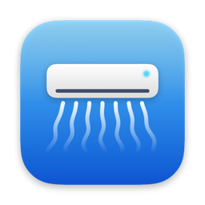
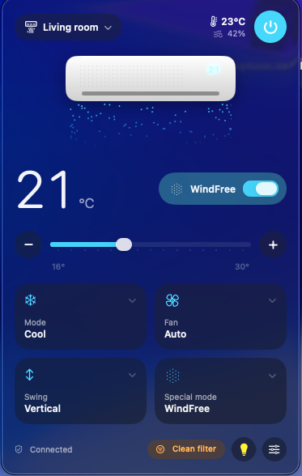

<p align="center">
  
</p>

<h1 align="center">Breeze</h1>

<p align="center">
  A tiny macOS menu bar app to control Samsung WindFree air conditioners through SmartThings.<br>
  Built with SwiftUI and Liquid Glass.
</p>

<p align="center">
  <a href="../../releases/latest"></a>
  
  
</p>

<p align="center">
  
</p>

## Features

- Power, target temperature (slider, `+`/`−` or the arrow keys), mode, fan speed and swing
- WindFree, WindFree Sleep and the other special modes
- Display light on/off — not exposed by the official API, see [how it works](docs/SMARTTHINGS.md#display-light-ocf-inverted)
- Room temperature and humidity, filter cleaning reminder, Auto Clean
- Multiple air conditioners with a quick device switcher
- Target temperature in the menu bar
- Stays in sync with the SmartThings app and the remote control
- English and Brazilian Portuguese

## Requirements

- macOS 26 Tahoe or later
- A Samsung air conditioner connected to SmartThings
- The [SmartThings CLI](https://github.com/SmartThingsCommunity/smartthings-cli) to create your own OAuth app (one-time setup)

## Installation

1. Download `Breeze-x.y.z.dmg` from the [latest release](../../releases/latest) and drag **Breeze** to **Applications**.
2. Open it. Breeze isn't notarized by Apple, so macOS blocks the first launch:
   open **System Settings → Privacy & Security**, scroll down and click **Open Anyway**. You only need to do this once.

## Setup

Breeze talks to the SmartThings API with **your own** OAuth credentials, which never leave your Mac.

1. Install the SmartThings CLI and sign in:

   ```bash
   brew install smartthingscommunity/smartthings/smartthings
   smartthings devices
   ```

2. Create an OAuth app:

   ```bash
   smartthings apps:create
   ```

   | Prompt | Answer |
   |---|---|
   | App type | **OAuth-In App** |
   | Display name | `Breeze` (or anything you like) |
   | Scopes | `r:devices:*`, `x:devices:*`, `r:locations:*` |
   | Redirect URI | `https://httpbin.org/get` |

3. Save the **OAuth Client Id** and **OAuth Client Secret** it prints in your Keychain
   (each command asks for the value without echoing it):

   ```bash
   security add-generic-password -U -s breeze-client-id -a "$USER" -w
   security add-generic-password -U -s breeze-client-secret -a "$USER" -w
   ```

4. Click the Breeze icon in the menu bar → **Connect**, sign in with your Samsung account and authorize the app.
   When macOS asks whether Breeze may use the Keychain items, choose **Always Allow**.

Breeze refreshes the access token automatically, so you only sign in once.

## Building from source

Requires Xcode 26 or later and [XcodeGen](https://github.com/yonaskolb/XcodeGen).

```bash
brew install xcodegen
xcodegen generate
open Breeze.xcodeproj
```

By default the app is signed ad-hoc. To sign with your own certificate (so the Keychain remembers the permission
across builds), create `Config/Local.xcconfig`:

```
CODE_SIGN_STYLE = Automatic
CODE_SIGN_IDENTITY = Apple Development
DEVELOPMENT_TEAM = YOUR_TEAM_ID
```

Other useful bits:

- `scripts/build-dmg.sh 1.0.0` builds a universal `dist/Breeze-1.0.0.dmg`.
- Launch with `-demo` to open the panel in a regular window with sample data — handy for UI work.
- `swift tools/make-icon.swift Breeze/Assets.xcassets/AppIcon.appiconset` regenerates the app icon.
- Pushing a tag like `v1.0.0` runs the [release workflow](.github/workflows/release.yml), which publishes the DMG.

## How it works

Breeze uses only the public SmartThings REST API. A couple of WindFree quirks (stale state after commands, the
inverted display light command) are documented in [docs/SMARTTHINGS.md](docs/SMARTTHINGS.md).

## Disclaimer

Breeze is an independent project and is not affiliated with, endorsed by or sponsored by Samsung Electronics.
Samsung, SmartThings and WindFree are trademarks of Samsung Electronics Co., Ltd.

## License

[MIT](LICENSE)
